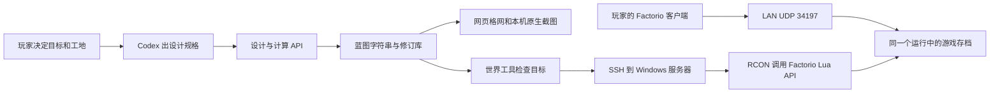

# 服务器现状与架构

## 玩家怎样使用

玩家给出目标产量、进出料、车厢配置及要保留的接口。Codex 将需求变成 JSON 工艺规格和布局，由离线设计器计算、组合和输出蓝图。网页显示蓝图格网与库内修订。原生客户端可在独立场景生成截图和实体验证。若玩家指定局域网存档与放置位置，施工工具先核对目标，再把同一份蓝图提交给运行中的游戏。

| 组件 | 位置 | 职责 |
| --- | --- | --- |
| 离线设计器 | `lib/` 和 `cli.mjs` | 蓝图编码、布局组件拼装、配方流量、站场与仓储核算 |
| 工作台与本地 API | `server.mjs` 和 `web/` | 在本机回环地址提供 JSON 接口、网页格网及蓝图库 |
| 原生引擎 | `native/` | 用已安装的 Factorio 在临时目录建造或截图 |
| 世界操作 | `world/` | 在局域网通过 SSH 和 RCON 读存档、检查工地、按玩家要求下发施工 |
| 服务配置存档 | `deployment/factorio-lab/` | 已部署实验服的 Compose、启动配置、模组清单和 LAN 转发脚本 |



## 已运行的实验服

核对日期按当前会话环境为 2026-11-26。SSH 主机为 `venblsserver@192.168.5.110`。容器 `factorio-codex-lab` 使用官方 Linux 无界面版 **2.1.25**，已启用 `base`、`space-age`、`quality`、`elevated-rails` 和 `recycler`。逻辑设计器、网页和蓝图库在本机运行。 [官方游戏发行包](https://factorio.com/download)

| 位置 | 当前用途 |
| --- | --- |
| `D:\Factorio-Lab\server` | Windows 端部署目录，包含 Compose、官方运行时、配置与存档 |
| `D:\Factorio-Lab\server\data\saves` | 运行存档及滚动自动存档，`codex-design-built.zip` 为 R12 建成后的命名快照 |
| `D:\Factorio-Lab\codex-worker` | 远端 RCON 客户端和原有 R12 验收脚本 |
| `D:\Factorio-Lab\server\config\rcon-password` | 仅存于服务器的 RCON 凭据文件 |
| `192.168.5.110:34197/udp` | 本机游戏直连，Windows 转发任务当前只接收 `192.168.5.139` |
| 服务器上的 `127.0.0.1:27015/tcp` | 管理连接。Codex 通过 SSH 在远端执行 RCON 客户端 |

本机已实连，玩家 `VenBls` 曾在 `codex-design-test` 查看施工结果。`world.mjs status` 会重新查询在线玩家、群组和可用表面。玩家换存档、星球、阵营或本机 IP 后应以实时结果为准。容器使用 `--start-server-load-latest`，重启时按存档文件时间选择地图。操作前以服务的实时状态与日志为准。 [客户端实连记录](../evidence/r12/client-join.json) · [建造后重载读回](../evidence/r12/R12-reloaded.json)

## 管理与恢复

部署文件按线上目录结构存放。官方运行时、凭据、游戏存档、日志和素材缓存留在部署机。已有服务可在服务器上使用以下命令查看。

```powershell
docker compose -f D:\Factorio-Lab\server\compose.yaml -p factorio-codex-lab ps
docker logs --tail 25 factorio-codex-lab
Get-ScheduledTask -TaskName Factorio-Codex-Lab-LAN-Bridge
Get-NetUDPEndpoint -LocalPort 34197
```

实验服使用 Windows Node UDP 入口和容器内 Perl 转发，运行日志位于 `D:\Factorio-Lab\server\data\lan-bridge.log`。建立这条路径前，Windows 网卡收到了客户端报文，Docker Desktop 的直转发没有回包。局域网玩家地址变化时，向 `lan-udp-ingress.mjs` 传入服务器绑定地址和新的授权 IPv4 地址，并更新对应 Windows 任务配置后复测。迁移到新主机时，检查脚本中的 Node、Docker 路径、用户名和本机地址。

如需恢复实验服，请先用 `docker compose ... ps` 和存档文件时间确认当前状态，再用正常的 Compose 启动命令加载指定存档或经核对的最新存档。维护时可以用 `game.server_save(name)` 创建命名快照。Lua 施工指令会影响本次加载的存档，且会触发 Factorio 的脚本指令成就限制。施工权限和存档恢复按玩家本次的范围执行。 [Factorio 保存 API](https://lua-api.factorio.com/latest/classes/LuaGameScript.html#server_save) · [RCON API](https://lua-api.factorio.com/latest/classes/LuaRCON.html)

## 当前验证范围

- 原生 Factorio 2.1.25 可导入并建成仓库的 R12 整合蓝图。蓝图含 857 个实体，7 座中文车站接轨，蓝图源可复建。
- 局域网实验服已读回上述实体和车站。实连的客户端和 Codex 可以通过各自入口观察同一存档中的结果。
- 通用世界工具在独立存档验证了整组实体直接建造、建筑和地砖幽灵、空地检查和回执复用。 [实体验证](../evidence/world/built-final.json) · [幽灵验证](../evidence/world/ghost-final.json)
- 独立生产测试报告使用早期站名版蓝图，条件、采样窗和列车装卸数据见报告。当前服务器上的 R12 是建造验证场，尚未接入持续供料、供水和供电。 [独立生产测试](../evidence/r12/engine-report.json) · [站名更新证明](../evidence/r12/naming-validation.json)

后续设计可以增加校验过的实体模板、指定版本的配方数据和装卸测试场景。调度网络的全局路线、跨棋盘格接驳与最终上线的范围由玩家逐个模块指定。
